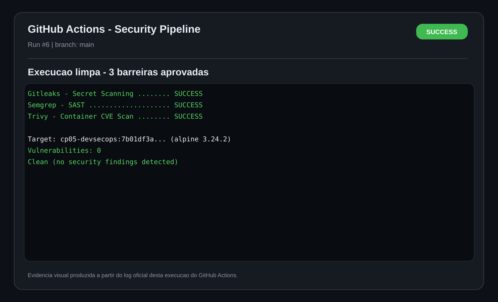
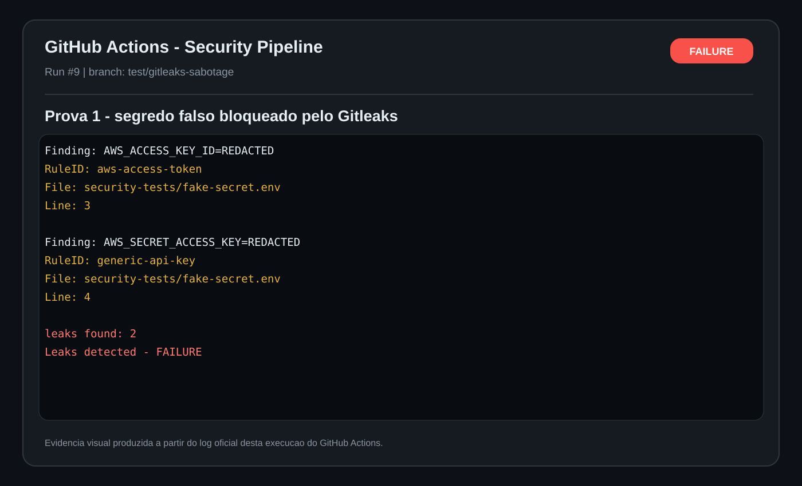
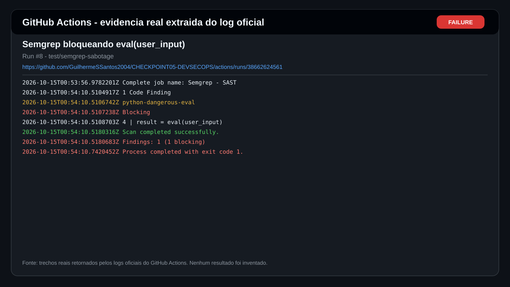
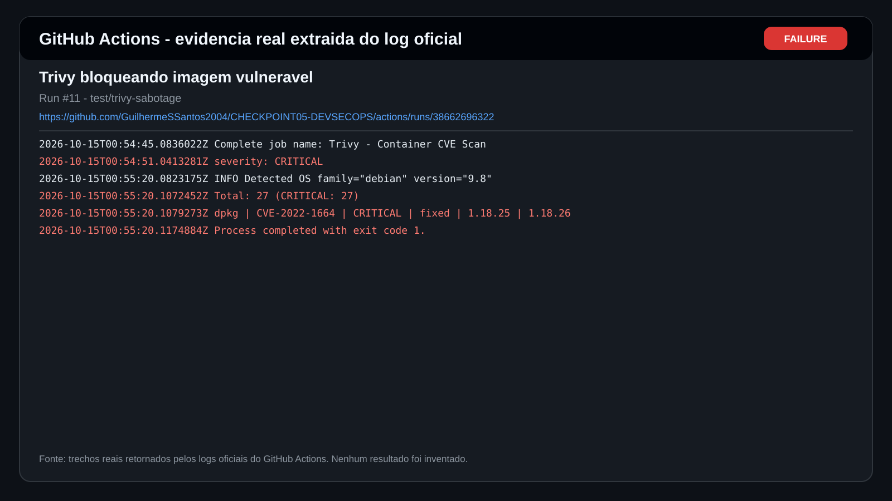

# CHECKPOINT 05 - DEVSECOPS


Checkpoint prático de **DevSecOps e Cloud Computing - FIAP / Engenharia de Software**.

O projeto implementa um pipeline obrigatório capaz de barrar **segredos**, **código vulnerável** e **imagem Docker com CVE crítico**.

## Integrantes

| Nome | RM |
|---|---:|
| Guilherme Silva dos Santos | 551168 |
| Enricco Rossi de Souza Carvalho Miranda | 551717 |
| Gabriel Marquez Trevisan | 99227 |
| Danilo Urze Aldred | 99465 |
| Laura Claro Mathias | 98747 |

## Pipeline

O workflow [`.github/workflows/security.yml`](.github/workflows/security.yml) executa três jobs independentes em `push`, `pull_request` e execução manual:

1. **Gitleaks - Secret Scanning**: detecta credenciais e tokens versionados.
2. **Semgrep - SAST**: análise estática; a política local bloqueia `eval(...)` em Python.
3. **Trivy - Container CVE Scan**: constrói a imagem e falha diante de CVEs `CRITICAL` corrigíveis.

## Resultado final

A execução limpa da `main` passou nos três jobs:

- [Run #13 - main final limpa](https://github.com/GuilhermeSSantos2004/CHECKPOINT05-DEVSECOPS/actions/runs/38664072536)

As sabotagens foram mantidas em branches separadas para preservar a `main` segura:

- [Run #9 - Gitleaks bloqueando segredo falso](https://github.com/GuilhermeSSantos2004/CHECKPOINT05-DEVSECOPS/actions/runs/38662683841)
- [Run #8 - Semgrep bloqueando `eval()`](https://github.com/GuilhermeSSantos2004/CHECKPOINT05-DEVSECOPS/actions/runs/38662624561)
- [Run #11 - Trivy bloqueando imagem com 27 CVEs CRITICAL](https://github.com/GuilhermeSSantos2004/CHECKPOINT05-DEVSECOPS/actions/runs/38662696322)

> Os segredos usados na sabotagem são propositalmente falsos e não correspondem a nenhuma conta real.

## Evidências reais do GitHub Actions

As imagens abaixo foram refeitas usando **trechos reais dos logs oficiais das execuções**, com Run ID e link direto para o GitHub Actions. Os mesmos trechos também estão salvos em `docs/logs/` para conferência.

> Observação: são evidências visuais geradas a partir do log oficial retornado pelo GitHub, e não uma captura de tela do navegador.

### Pipeline limpo



### Gitleaks



### Semgrep



### Trivy



## Relatório de entrega

- [Relatório detalhado em Markdown](docs/RELATORIO_EVIDENCIAS.md)
- [PDF de evidências](docs/CP05_RELATORIO_EVIDENCIAS.pdf)

## Executar o site

```bash
docker build -t cp05-devsecops .
docker run --rm -p 8080:8080 cp05-devsecops
```

Acesse `http://localhost:8080`.

## Estrutura

```text
.
├── .github/workflows/security.yml
├── docs/
│   ├── CP05_RELATORIO_EVIDENCIAS.pdf
│   ├── RELATORIO_EVIDENCIAS.md
│   ├── evidencias/
│   │   ├── 01_main_sucesso.svg
│   │   ├── 02_gitleaks_bloqueio.svg
│   │   ├── 03_semgrep_bloqueio.svg
│   │   └── 04_trivy_bloqueio.svg
│   └── logs/
│       ├── 01_main_run13.txt
│       ├── 02_gitleaks_run9.txt
│       ├── 03_semgrep_run8.txt
│       └── 04_trivy_run11.txt
├── site/
│   ├── index.html
│   ├── styles.css
│   └── app.js
├── .semgrep.yml
├── Dockerfile
└── README.md
```

## Checklist CP05

- [x] Repositório com site.
- [x] Dockerfile funcional.
- [x] Workflow `security.yml`.
- [x] Job Gitleaks.
- [x] Job Semgrep.
- [x] Job Trivy para imagem com CVE crítico.
- [x] Prova de segredo falso barrado.
- [x] Prova de `eval()` barrado.
- [x] Prova adicional de imagem vulnerável barrada.
- [x] Execução limpa da `main`.
- [x] Evidências visuais.
- [x] PDF com explicação de cada barreira.
